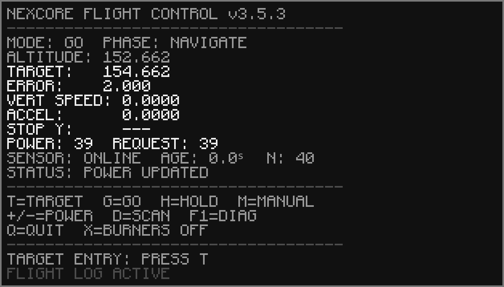

# NEXCORE Flight Control v3.5.3

Original-interface restoration built directly from the user-supplied **Nexcore-Flight-Control-main.zip**, the working v3.5.2 controller. The original screenshot defines the main screen; the working ZIP defines flight behavior.



The preview is a rendered terminal fixture, not an in-game screenshot. Its glyph shapes were sampled from the supplied design reference; live values and status messages come from the retained backend.

## Controls

| Key | Action |
| --- | --- |
| T | Set target absolute altitude; Enter accepts, Escape cancels |
| G | GO: select nearest calibrated integer power once |
| H | HOLD current power |
| M | MANUAL |
| + / - | Adjust manual power by exactly one, including keypad |
| D | Diagnostic scan, unchanged |
| F1 | Toggle main/diagnostics page; new presentation-only shortcut |
| Q | Exit to computer shell, leave burners running |
| X | Turn burner redstone enables off and exit; retain scroll values |

Q/X remain active during target entry and worker restart backoff. Ctrl+T exits hands off. F1 works while typing a target without losing the entry. H holds power, not altitude PID. GO remains the original one-time calibrated power selection, with the original stale-data guard and arrival-to-HOLD check.

## Install / publish

**Extract this ZIP first. GitHub does not unpack uploaded ZIPs.** Upload the extracted repository contents with folder structure preserved. Drag the actual `config` and `src` folders into GitHub's upload area; do not open those folders and upload their individual contents into the repository root. Alternatively use VS Code's Git support to push the extracted repository.

Before installing, verify these paths exist on GitHub:

```text
install.lua
manifest.json
nexcore.lua
config/default.lua
config/local.example.lua
src/nexcore/app.lua
src/nexcore/display.lua
src/nexcore/control.lua
src/nexcore/hardware.lua
src/nexcore/supervisor.lua
src/nexcore/log.lua
src/nexcore/calibration.lua
src/nexcore/util.lua
```

The ZIP has repository files directly at its root, with no extra project-folder nesting. Uploading the ZIP itself is optional archival storage and does not install its contents.

For the existing public repository, after uploading **this release's files**, use:

```text
wget https://raw.githubusercontent.com/sams930771/Nexcore-Flight-Control/main/install.lua nexcore-install-353.lua
nexcore-install-353.lua sams930771 Nexcore-Flight-Control main nexcore
nexcore/nexcore.lua
```

Replace the final destination `nexcore` with your existing working folder (for example `nexcore-ready`) to update that installation and retain its local configuration/logs. Launch that folder's `nexcore.lua` afterward. Installation does not start flight control or change outputs. Run Q in a controller before updating its files. The controller enables both redstone outputs when launched, as the working version does, while preserving current scroll values.

For a different repository, replace the owner/repository and branch in both commands. Use a commit SHA instead of `main` for a fixed release. HTTP must be enabled on the server, and the repository files must be publicly accessible. No GitHub credentials are embedded. No repository upload was performed as part of this delivery.

The installer stages the 13 runtime files, checks byte sizes and syntax, keeps the old folder as `.backup`, and copies `config/local.lua` and `logs` into the new installation. Failed downloads leave the old installation intact. Existing `.stage` or `.backup` folders are never overwritten: inspect and rename them before retrying. Keep your old logs. A failed final folder move attempts rollback. Byte sizes detect incomplete files, not malicious replacement; install only from a trusted repository.

After editing runtime files, run `python tools/build_manifest.py` before pushing. Upload `manifest.json` together with changed files. Optional `startup.example.lua` runs the controller once; copy it to `/startup.lua` only if automatic launch is wanted and adjust its destination path.

## Hardware / ship calibration

Defaults are unchanged except the release number: back sensor **getHeight**, left/right burners **getScrollValue / setScrollValue**, manual integer power **0–500**, GO **38–48**, tick interval **0.25 s**, arrival tolerance **0.35 blocks** and vertical speed below **0.05 blocks/s**.

| Power | Recorded altitude |
| ---: | ---: |
| 39 | 146.3424 |
| 42 | 164.8510 |
| 43 | 170.7356 |
| 44 | 176.4890 |
| 46 | 187.6230 |
| 47 | 193.0140 |

These are measurements for the original test ship/load. They are not automatically correct for another ship. `config/local.lua` can replace the calibration table for a specific ship; `config/local.example.lua` shows the override mechanism. Keep independent local configuration copies for different ships. Hardware, calibration and display modules remain separate; supporting more than two burners requires a future hardware/validation change and is not enabled by this UI release.

## Restored main screen and truthful estimates

The 19-row screen restores the screenshot's NEXCORE header/version placement, monochrome styling, field alignment, three separators and control/entry/footer blocks. Main data includes altitude, target, error, vertical speed, acceleration, STOP Y, power/request, sensor freshness and status. F1 provides sample/attempt/failure counters, ages, heartbeats, call stages, per-burner readbacks, calibrated equilibrium estimate and errors.

**STOP Y is `---`: the working backend contains no stopping-distance/braking model.** Its calibrated altitude prediction is an equilibrium estimate, not a stopping position, and is labeled **CAL ALT** on F1. A false stopping altitude has not been substituted. ACCEL is a presentation-only finite difference of velocity across observed successful sample timestamps; it is `---` until two samples are observed. Neither field influences flight control. PHASE is an informational label derived from the current mode/pending state, not a reinstated old autopilot state machine.

POWER is the last fully verified pair command; during an in-flight write it can lag actual per-side hardware. REQUEST shows a queued value and shows `---` during the in-flight write, because the working backend does not expose that command's value separately. F1 shows observed per-burner readbacks; these refresh on startup, scans and writes, not continuously for changes made externally. Partial-write errors remain blocked until D rescans, as in the working version.

## Freeze prevention retained

The working app, hardware, supervisor, logging, utility, calibration and launcher modules are byte-for-byte unchanged. Only `display.lua` was replaced and an F1 branch added to `control.lua`; defaults/installer/manifest received the release number. Display rendering performs no event pulls, reads, sleeps, or peripheral operations.

The four supervised parallel workers, raw unfiltered UI events, independent sensor polling, nonblocking editor, timer handling, serial burner read/write verification and error recovery remain intact. Samples continue while stationary. Sensor age and unchanged age stay distinct. Existing full errors remain in rotating `logs/events.jsonl` / `logs/telemetry.jsonl`; `inspect.lua` produces a read-only inventory. F1's error row is a summary; use logs for full tracebacks.

A yielding mod call can wait without blocking UI workers. A non-yielding native call or server-wide stall can still stop all Lua work; this release does not claim to solve those external cases. In-game hardware was not tested here.

## Verification and source layout

Run from repository root with Lua 5.2 and Python installed:

```sh
lua5.2 tests/run.lua
python3 tests/check_manifest.py
```

GitHub Actions also compiles every Lua source. See [test results](docs/TEST_RESULTS.md), [screenshot comparison](docs/INTERFACE_COMPARISON.md), and [unchanged-backend hashes](docs/BACKEND_COMPARISON.txt).

`src/nexcore/` contains the modular runtime, `config/` contains defaults/overrides, `tests/` contains event/installer/launcher/display regression checks, `tools/` builds the manifest, and `docs/` contains previews and diagnostic/architecture notes. VS Code settings and GitHub CI are included under their normal dotfolders. Legacy flattened files and nested ZIP copies from the supplied download were excluded.
